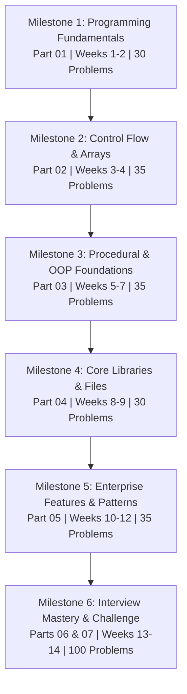

# ☕ The Complete Java Programming Practice Roadmap

### A Coding Bootcamp Curriculum: From Absolute Beginner to Interview-Ready

---

> **Target Audience**: Freshers, Career Switchers, Automation QA Engineers, and Developers preparing for coding interviews.  
> **Total Curriculum**: 6 Milestones | 9 Content Parts | **308 Carefully Curated Practice Problems**  
> **Key Feature**: Fully interactive progress tracking. Check off solved problems on the dashboard, and your mastery stats will save to your browser's `localStorage` automatically!

---

## 📊 Roadmap Overview & Milestones

The roadmap is structured in a progressive path where each milestone builds on the tools and concepts mastered in the previous ones.



---

## 📋 Table of Contents

### 1. Milestone 1: Java Programming Fundamentals (Part 1)
* **File**: [Part_01_Fundamentals.md](file:///Users/paywize/Desktop/Testing%20Guide/java-roadmap/Part_01_Fundamentals.md)
* **Weeks**: 1-2
* **Problems**: 30 (Easy → Medium → Hard)
* **Key Topics**: Print Statements, Basic Java Syntax, Variables, Primitive Data Types, Operators, String Manipulation, Scanner User Input, Algorithmic Problems Level 1.
* **Mini-Project**: Interactive CLI Personal Finance Tracker & Budget Planner.

### 2. Milestone 2: Control Flow & Basic Data Structures (Part 2)
* **File**: [Part_02_ControlFlow_Arrays.md](file:///Users/paywize/Desktop/Testing%20Guide/java-roadmap/Part_02_ControlFlow_Arrays.md)
* **Weeks**: 3-4
* **Problems**: 35 (Easy → Medium → Hard)
* **Key Topics**: Conditional Statements (`if-else`, `switch`), Loop Control (`for`, `while`, `do-while`, nested loops), Single & Multi-dimensional Arrays, Algorithmic Problems Level 2 & 3.
* **Mini-Project**: CLI Student Grade Management & Reporting System.

### 3. Milestone 3: Object-Oriented Programming (Part 3)
* **File**: [Part_03_Methods_OOP.md](file:///Users/paywize/Desktop/Testing%20Guide/java-roadmap/Part_03_Methods_OOP.md)
* **Weeks**: 5-7
* **Problems**: 35 (Easy → Medium → Hard)
* **Key Topics**: Methods in Java, Class & Object Definitions, Constructors, Encapsulation, Inheritance, Polymorphism (Overloading vs. Overriding), Abstraction (Abstract Classes vs. Interfaces), OOP Design Principles.
* **Mini-Project**: CLI-based Banking Transaction System.

### 4. Milestone 4: Exception Handling, Collections, and File IO (Part 4)
* **File**: [Part_04_Exceptions_Collections_IO.md](file:///Users/paywize/Desktop/Testing%20Guide/java-roadmap/Part_04_Exceptions_Collections_IO.md)
* **Weeks**: 8-9
* **Problems**: 30 (Easy → Medium → Hard)
* **Key Topics**: Try-Catch-Finally, Throw vs. Throws, Custom Exceptions, Java Collections (List, Set, Map, Queue, Stack), File Input/Output (FileReader, BufferedReader, NIO, Object Serialization).
* **Mini-Project**: Local Inventory Management System with File Persistence.

### 5. Milestone 5: Modern Java 8+, Concurrency & Design Patterns (Part 5)
* **File**: [Part_05_Modern_Java_Patterns.md](file:///Users/paywize/Desktop/Testing%20Guide/java-roadmap/Part_05_Modern_Java_Patterns.md)
* **Weeks**: 10-12
* **Problems**: 35 (Easy → Medium → Hard)
* **Key Topics**: Lambda Expressions, Functional Interfaces, Streams API (`map`, `filter`, `reduce`), Optional Class, Multithreading & Runnable, ExecutorService, Synchronization, JDBC Database Operations, Design Patterns (Singleton, Factory, Builder, Observer).
* **Mini-Project**: Multithreaded Database-backed Library Management Console.

### 6. Milestone 6: Technical Interview Preparation & Mastery (Parts 6 & 7)
* **Interview Practice File**: [Part_06_Interview_Problems.md](file:///Users/paywize/Desktop/Testing%20Guide/java-roadmap/Part_06_Interview_Problems.md) (40 Problems)
  * Focuses on algorithmic data structures: Linked Lists, Trees, Graphs, Two Pointers, Binary Search, Recursion, and Dynamic Programming.
* **Mastery Challenge File**: [Part_07_Mastery_Challenge.md](file:///Users/paywize/Desktop/Testing%20Guide/java-roadmap/Part_07_Mastery_Challenge.md) (60 Problems)
  * A collection of 60 mixed-concept, real-world algorithmic problems.
* **Curriculum Plans**: [Part_08_Weekly_Plans_Projects.md](file:///Users/paywize/Desktop/Testing%20Guide/java-roadmap/Part_08_Weekly_Plans_Projects.md)
  * High-frequency coding interview checkpoints, day-by-day practice schedules, and detailed milestone project guidelines.

### 7. Java Practice Center (Part 9)
* **File**: [Part_09_Practice_Java.md](file:///Users/paywize/Desktop/Testing%20Guide/java-roadmap/Part_09_Practice_Java.md)
* **Problems**: 43 (Easy → Medium → Hard)
* **Key Topics**: Categorized programming problems for: Basics (Beginner Level), Variables & Data Types, If-Else, Switch, All Loops, Strings, Methods, and Object-Oriented Programming (OOP) concepts.

### 8. Recent Company Interviews (Part 10)
* **File**: [Part_10_Recent_Interviews.md](file:///Users/paywize/Desktop/Testing%20Guide/java-roadmap/Part_10_Recent_Interviews.md)
* **Problems**: 35 (Easy → Medium → Hard)
* **Key Topics**: Hand-picked Java programming questions asked in recent tech assessments and coding interviews at top Indian companies and startups (TCS, Infosys, Wipro, Cognizant, Zoho, Flipkart, Swiggy, Zomato, Paytm, Razorpay), complete with company tags.

### 9. Write-Your-Own Practice Tracker (Part 12)
* **File**: [Part_12_WriteYourOwn_Practice_Tracker.md](./Part_12_WriteYourOwn_Practice_Tracker.md)
* **Problems**: 350, across 14 categories (Basic Programs, Operators, If-Else, Loops, Patterns,
  Arrays, Strings, Methods, OOP, Exceptions, Collections, File Handling, Java 8, Advanced DSA)
* **Key Feature**: Same interactive format as Part 9/11 — checkboxes, difficulty/topic tags, and
  a full reference solution behind every problem. Try it yourself first, then check the
  "Solution" tab. Merged in from the standalone `practice-java-questions-and-answers` companion
  repo so every practice track lives in one place.

---

## 🗝️ Core Icons & Formatting Styles

The curriculum uses visual labels to organize learning points:

| Icon | Purpose |
|------|---------|
| 📌 | **Core Concept**: Theoretical highlight or language spec detail. |
| 💡 | **Best Practice**: Production-level standard guidelines. |
| ⚠️ | **Beginner Pitfall**: Crucial mistakes to debug and avoid. |
| 🚀 | **Relevance**: Explains how the concept maps to real-world software engineering. |
| 🧠 | **Complexity**: Time and space constraints ($O(N)$, $O(1)$). |

---

## 🎯 How to Start Coding

To compile and execute Java programs on your local machine:

1. **Install JDK 17 or 21**: Download from [Adoptium / Eclipse Temurin](https://adoptium.net/) or Oracle.
2. **Setup your environment**: Add Java to your PATH. Verify installation by running:
   ```bash
   java -version
   javac -version
   ```
3. **Write and Run**: Save your code as `Main.java` and execute:
   ```bash
   javac Main.java
   java Main
   ```

> [!TIP]
> **Use the Filters Above**: When reviewing milestone files, use the top dashboard filters to hide solved problems, focus on a specific difficulty level, or select individual topics to target your weak spots!
